<p align="center">
  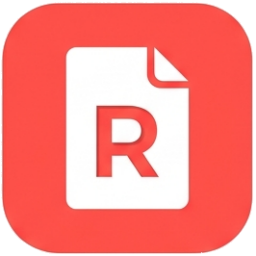
</p>

<h1 align="center">RonyPDF</h1>

<p align="center">
  <b>Une, divide, organiza, comprime, edita, comenta y sella, rellena y firma, censura, compara, imprime y reconoce el texto de tus PDF.</b><br>
  También convierte Word, Excel y PowerPoint a PDF, y PDF a Word y Excel, y aplica varios pasos seguidos a carpetas enteras.<br>
  Portable para Windows: se descomprime y se abre, no se instala, no necesita internet y tus archivos nunca salen del equipo.
</p>

<p align="center">
  <a href="https://github.com/Rony0218/RonyPDF/actions/workflows/pruebas.yml"></a>
  <a href="https://github.com/Rony0218/RonyPDF/releases/latest"></a>
  <a href="LICENSE"></a>
  
</p>

<p align="center">
  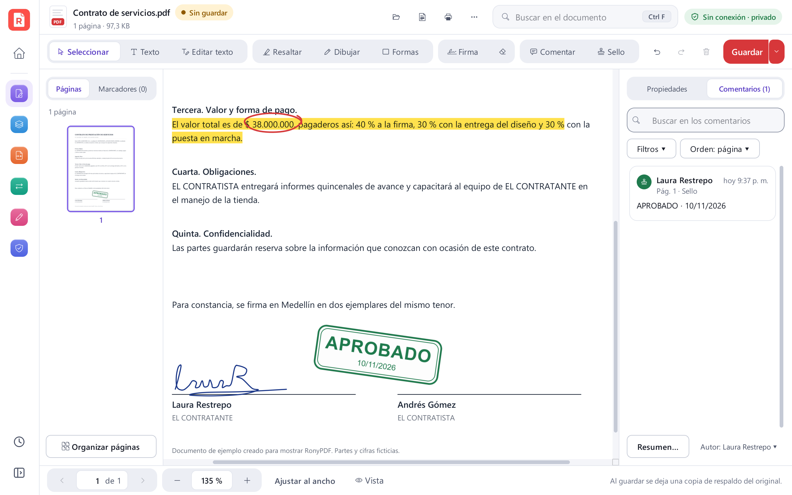
</p>

> **In English:** RonyPDF is a free, portable PDF toolkit for Windows (Spanish UI): view and edit (text selection,
> bookmarks, two-page view, full screen and night mode), comment with your own name and your own stamps (standard
> PDF annotations, threaded replies and statuses), save in place with automatic backups, incremental saving,
> autosave and crash recovery, compare two PDFs side by side, fill and sign forms, print with a live preview (N-up,
> booklet, poster, guided duplex), redact personal data with Colombian patterns and remove hidden data, convert
> Word/Excel/PowerPoint to PDF and PDF to Word/Excel, run chained batch actions on whole folders and rename files by
> their content, OCR scanned documents (deskew, auto-rotate, cleanup and a review screen for doubtful words), merge,
> split, reorder pages, compress, watermark, number pages and password-protect. A portable, offline zip (no installer), built with
> Python, Qt (PySide6) and MuPDF, with 582 automated tests running on GitHub Actions. Version 2.0 is a full visual
> redesign: one pastel color per tool category, a shared step-by-step layout for every tool and a Ctrl K command
> palette that understands everyday words.

## Qué hace

| | Herramienta | Qué hace |
|---|---|---|
|  | **Ver y editar** | Visor con búsqueda y zoom, **selección y copia de texto**, panel de marcadores, enlaces, vista de dos páginas, pantalla completa y modo noche. Agrega texto, edita líneas existentes, resalta, dibuja, inserta imágenes o firmas y **borra zonas de verdad** (el texto tapado desaparece del archivo). **Comenta con tu nombre**: notas, subrayado, tachado, cuadros de texto y tus sellos, con respuestas, estados y un panel para buscarlos. **«Guardar» directo** con copia de respaldo, deshacer y **rehacer**. |
|  | **Mis sellos** | Diseña **tus propios sellos** (texto, tu nombre y tu cargo, fecha y hora automáticas, forma, color y la imagen de tu firma o de tu logo) y ponlos con un clic en cualquier PDF, o en todos los de una carpeta con «Acciones por lotes». |
| 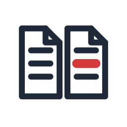 | **Comparar dos PDF** | Encuentra qué cambió entre dos versiones: palabras agregadas, quitadas o cambiadas, páginas nuevas, quitadas o movidas, y diferencias en imágenes, gráficos y sellos. Las muestra **lado a lado**, con una lista para ir de un cambio al siguiente, y hace un **informe en PDF o Excel**. |
| 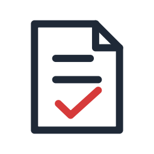 | **Formularios y firma** | Rellena todos los tipos de campo (texto, casillas, opciones, listas y desplegables), pasa de uno a otro con Tab y avisa los obligatorios que faltan. Firma **dibujando, escribiendo o con una foto de tu firma**, y pone equis, chulos, fechas o texto en PDF que no tienen campos. |
| 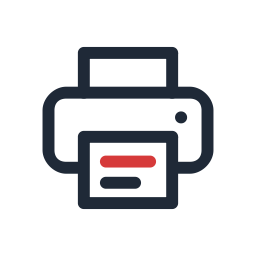 | **Imprimir** | Vista previa de cada hoja, rango, impares o pares, **de 2 a 16 páginas por hoja**, **folleto** para doblar y grapar, **póster** en varias hojas y **doble cara guiada** en impresoras que no la hacen solas. También guarda el resultado como PDF. |
|  | **Reconocer texto (OCR)** | Vuelve buscable un PDF escaneado: agrega una capa de texto invisible y la página se ve igual. Antes **endereza, gira y limpia** las páginas que lo necesitan. Un documento, varios o **una carpeta completa**. Español e inglés incluidos, sin internet. |
| 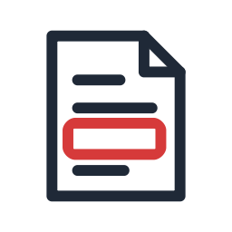 | **Revisar texto reconocido** | Marca en ámbar y en rojo las palabras dudosas, junto al recorte de la imagen y con sugerencias, para **corregirlas antes de guardar** el PDF buscable. |
|  | **Unir** | Combina PDF **e imágenes**, en el orden que quieras y con rangos por archivo (`1-3, 5, 8-`). |
|  | **Dividir** | Por páginas, cada *N* páginas, por rangos o por capítulos (marcadores). |
|  | **Organizar páginas** | Miniaturas para reordenar arrastrando, rotar, duplicar, eliminar o insertar páginas, con deshacer. |
| 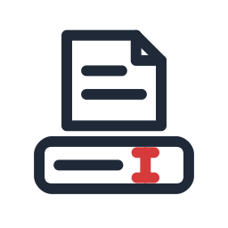 | **Renombrar por contenido** | Nombra facturas, cuentas de cobro y cartas con su **fecha, NIT, cédula o número de factura**, leídos del documento (también en escaneos). Muestra los nombres nuevos antes de cambiarlos y se puede deshacer. |
|  | **Comprimir** | Cuatro niveles, en lote y con opción de escala de grises. Muestra cuánto se ahorró. |
| 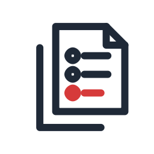 | **Acciones por lotes** | Aplica **varios pasos seguidos** (OCR, comprimir, numerar, marca de agua, censurar, quitar datos ocultos, poner un sello, proteger, imprimir…) a muchos archivos o a una carpeta entera, con vista previa, flujos guardados e informe final. Los originales no se tocan. |
| 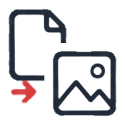 | **PDF ↔ imágenes** | Páginas a PNG/JPG (72–300 ppp) e imágenes a PDF (corrige la rotación de las fotos del celular). |
| 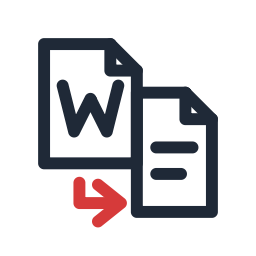 | **Word, Excel y PowerPoint a PDF** | Uno por uno o **todos unidos en un solo PDF**, mezclados con PDF e imágenes y con un marcador por archivo. Usa el Microsoft Office del equipo, sin abrir ventanas, o LibreOffice si no hay Office. |
| 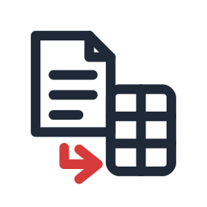 | **PDF a Word y Excel** | A Word conservando el diseño (con Microsoft Word) o como texto limpio con títulos, negritas y cursivas, también en escaneados. A Excel, cada tabla en su hoja, con las cifras colombianas (`$ 1.250.000,50`) como números y las cédulas y los NIT como texto. |
|  | **Marca de agua y numeración** | Con vista previa en vivo. |
| 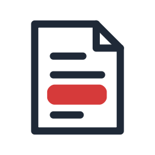 | **Censurar datos** | Encuentra y **borra de verdad** cédulas, NIT, celulares, teléfonos fijos, correos, cuentas, tarjetas y direcciones con patrones colombianos, y los nombres o palabras que escribas. Muestra cada dato marcado en la página antes de aplicar, detecta censuras falsas (recuadros negros con el texto debajo) y **verifica** que no quedó nada. |
| 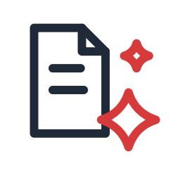 | **Quitar datos ocultos** | Muestra y elimina lo que viaja escondido en el PDF: autor y metadatos, adjuntos, JavaScript, comentarios, campos, enlaces, marcadores, miniaturas y texto invisible. |
|  | **Proteger y desbloquear** | Cifrado AES de 256 bits y permisos (imprimir, copiar, modificar). |
| 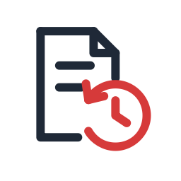 | **Respaldo y recuperación** | Vuelve a una versión anterior de tus PDF y **recupera lo que no alcanzaste a guardar** después de un cierre inesperado. |

Además: extraer texto e imágenes, editar propiedades, archivos recientes, búsqueda de herramientas con **Ctrl K**,
atajos de una letra en el editor y menú lateral que se contrae. Un `.docx`, `.xlsx` o `.pptx` abierto o soltado en el
inicio va directo a la conversión, y el visor avisa cuando el PDF es un formulario y tiene botones para imprimir
(**Ctrl P**) o censurar el documento abierto. Las herramientas que crean un archivo nuevo nunca sobrescriben el
original: los resultados llevan un sufijo (`_rellenado`, `_censurado`, `_limpio`…). «Guardar» en el mismo archivo
pregunta la primera vez y antes deja una copia de respaldo. Todas **conservan la contraseña** del documento.

## Detalles prácticos

**Ver y editar**
- La herramienta Seleccionar (**V**) selecciona texto al arrastrar sobre una palabra, mueve lo que agregaste y
  desplaza la página en una zona vacía. Doble clic toma una palabra, triple clic el renglón, **Ctrl A** la página y
  **Ctrl C** copia. Con el clic derecho también se resalta o se busca lo seleccionado.
- Atajos: **F11** pantalla completa, **Ctrl H** modo lectura, **Ctrl G** ir a una página, **Ctrl R** girar la vista
  (no cambia el archivo) y **Alt ←** para volver después de seguir un enlace del documento.
- Los enlaces a páginas web o correos piden confirmación antes de abrirse; los demás tipos de enlace no se abren.
- El modo noche y la vista de dos páginas se recuerdan. Al reabrir un documento sigue en la página donde lo dejaste
  (hasta 50 documentos, solo si la lista de recientes está activa).

**Tus comentarios y tus sellos**
- Los botones «Comentar» y «Sello» de la barra, o las teclas **N** (nota), **U** (subrayar), **K** (tachar), **X**
  (cuadro de texto) y **S** (sello). La nota se escribe en un recuadro junto a ella; **Esc** o un clic afuera la
  termina. Con **Mayús** se siguen poniendo sellos sin volver a elegirlos.
- Cada comentario lleva **tu nombre**: se pregunta la primera vez que comentas o sellas (nunca al abrir la
  aplicación) y se cambia desde «Autor: … ▾» en el panel. Los resaltados de la herramienta «Resaltar» también lo
  llevan. No hay nombres, logos ni sellos de ninguna organización.
- Son anotaciones PDF estándar, con autor y fecha: se ven, se responden y se pueden mover en cualquier lector de PDF.
  Los comentarios que ya traía el archivo se pueden mover, editar y responder sin perder su apariencia. Al organizar
  las páginas, unir o dividir, cada comentario conserva sus respuestas y su estado.
- Con Seleccionar, un clic elige un comentario para moverlo, cambiarle el tamaño (sellos y cuadros), editarlo con
  doble clic o borrarlo con **Supr**. Con el clic derecho: Responder, Estado (Aceptado, Rechazado, Cancelado,
  Completado), Cambiar color o Eliminar.
- Panel «Comentarios (n)»: búsqueda sin importar las tildes, filtros por tipo, autor y estado, «Solo los míos» y «Sin
  responder», y orden por página, fecha o autor. En «Más acciones» están «Resumen de comentarios…» (PDF con las
  miniaturas numeradas, Excel, Word o texto) y «Aplanar comentarios en una copia…».
- **Mis sellos:** cada sello tiene su texto y, si quieres, `{nombre}`, `{cargo}`, `{fecha}`, `{hora}` o
  `{fecha_hora}`, que se llenan al sellar (12/03/2025, 3:42 p. m.); además forma, color, borde, letra, inclinación,
  «Fondo blanco» (activo de entrada, para que se lea encima del texto de la página) y la imagen de tu firma o de tu
  propio logo, con vista previa en vivo. Puedes tener hasta 30; quedan solo en este
  equipo, en la carpeta `RonyPDF_sellos`, y se exportan e importan como `.ronysello` para llevarlos a otro equipo.
  Los cuatro de «Para empezar» (Recibido, Aprobado, Revisado y Copia) son genéricos y sirven de base.

**Guardar, respaldos y recuperación**
- «Guardar» (**Ctrl S**) escribe en el mismo archivo. La primera vez en la sesión lo confirma (con «No volver a
  preguntar») y antes de reemplazarlo guarda una copia con fecha en `RonyPDF_respaldos`: 5 copias por documento,
  30 días y 500 MB en total, cambiables en «Respaldo y recuperación». Si la copia no se puede hacer, no guarda encima.
  «Guardar como…» (**Ctrl Mayús S**) está en la flecha del botón.
- Cuando nada se borra, los cambios se agregan al final del archivo y los bytes originales quedan intactos (así no se
  dañan las firmas digitales). Borrar una zona, editar una línea, borrar un comentario o cambiarle el texto, o aplanar
  reescribe el archivo completo y lo borrado no queda dentro; si el PDF tiene una firma digital, lo avisa antes.
- También avisa si el archivo cambió fuera de RonyPDF, si es de solo lectura o si se movió. Si el mismo PDF está
  abierto en otra pantalla de RonyPDF (por ejemplo, en el visor y en «Organizar páginas»), lo suelta allí mientras
  guarda y lo vuelve a abrir ya guardado; si esa pantalla tiene cambios sin guardar, avisa y no guarda encima.
- **Rehacer** con **Ctrl Y** o **Ctrl Mayús Z** en el visor y en los formularios.
- Mientras trabajas, el visor, los formularios y el organizador se autoguardan cada minuto en segundo plano (carpeta
  `RonyPDF_recuperacion`). Si la aplicación se cierra de forma inesperada, al abrirla otra vez ofrece «Recuperar
  trabajo sin guardar». Al salir o abrir otro archivo con cambios pregunta «Guardar», «No guardar» o «Cancelar».
- En el visor, «Más acciones» → «Versiones anteriores de este PDF…» muestra sus copias de respaldo.

**Formularios y firma**
- Guarda una copia `_rellenado.pdf`. Con «Aplanar al guardar» los valores quedan fijos y ya no se pueden cambiar.
- Los datos se pueden exportar e importar en JSON o CSV (menú «Datos»), útil para llenar el mismo formulario muchas
  veces. También acepta fotos de documentos.
- La firma es una imagen (firma visual), no una firma digital con certificado. Puedes guardar hasta 6 firmas; quedan
  solo en este equipo, en la carpeta `RonyPDF_firmas` junto al archivo de ajustes, y se borran desde el mismo diálogo.
  Para escribirla se usan las letras manuscritas que traiga Windows (Segoe Script, Ink Free o Lucida Handwriting).
- Si pones una firma en imagen sobre un campo de firma vacío, ese campo se quita del resultado y ya no sirve para
  una firma digital posterior.
- No recalcula fórmulas ni ejecuta el JavaScript de los formularios: lo avisa. De un formulario XFA dinámico solo se
  ve la parte AcroForm.

**Imprimir**
- Desde el visor, si hay cambios sin guardar, se imprime una copia temporal que los incluye (en
  `%TEMP%\RonyPDF-imprimir`; se borra al salir).
- Doble cara manual: imprime el frente, te dice cómo devolver las hojas a la bandeja y luego imprime el dorso. La
  casilla para invertir el orden se recuerda. La primera vez con una impresora, prueba con dos hojas.
- Recuerda la impresora, el papel, la doble cara, el color y la calidad. Si no hay impresoras instaladas, queda
  «Guardar como PDF…».

**Word, Excel y PowerPoint**
- Para pasar Office a PDF se necesita Microsoft Office o LibreOffice instalado. También sirve un LibreOffice portable
  en una carpeta `LibreOfficePortable` junto a `RonyPDF.exe`.
- Acepta `.doc`, `.docx`, `.docm`, `.rtf`, `.odt`, `.xls`, `.xlsx`, `.xlsm`, `.xlsb`, `.ods`, `.ppt`, `.pptx`,
  `.pptm`, `.pps`, `.ppsx` y `.odp`. Office se abre sin ventanas y con las macros desactivadas.
- Un archivo con contraseña o dañado da error en su fila y el lote sigue con los demás. Cancelar cierra solo el
  Office que abrió RonyPDF: un documento que tengas abierto en tu propio Word no se toca.
- «Conservar el diseño» de PDF a Word usa Word. Si Word todavía muestra su aviso de conversión de PDF, se abre a la
  vista para que pulses Aceptar. «Solo texto y títulos» no necesita Office y reconoce el texto de las páginas
  escaneadas. Las tablas también se pueden guardar como `.csv` separado por punto y coma.

**Censurar datos y quitar datos ocultos**
- Pensado para compartir documentos sin exponer datos personales (Ley 1581 de 2012, Habeas Data). La cédula se busca
  solo cuando lleva delante C.C., T.I., NUIP u otro tipo de documento; el NIT se comprueba con el dígito de
  verificación y las tarjetas con el algoritmo de Luhn. Placas y fechas vienen desmarcadas.
- Las palabras se encuentran aunque cambien las tildes o las mayúsculas, y un número de cédula se encuentra con o
  sin puntos. «Cargar lista…» lee nombres de un archivo de texto.
- Lo censurado se borra del archivo (texto, imagen y dibujos), junto con los campos, comentarios y enlaces que tocan
  la zona. El resultado se guarda como `_censurado.pdf` y después se revisa todo el archivo, metadatos y adjuntos
  incluidos: si el dato sigue en alguna parte, lo dice y ofrece «Quitar datos ocultos».
- En páginas escaneadas usa el OCR: revisa los datos marcados «OCR: revisa». También las revisa cuando el escaneo
  trae encima un poco de texto digital (un sello de radicado, un encabezado, «Página 1 de 2»). Para firmas, fotos,
  sellos o letra a mano está «Marcar zona a mano». El texto convertido en trazos no se detecta.
- Lo que sigue en el mismo renglón queda en su sitio: no se corre debajo del recuadro, y al auditar la copia
  censurada no aparecen falsas alarmas.

**Comparar dos PDF**
- Compara el texto del documento completo, palabra por palabra: si un párrafo nuevo corre el resto a la página
  siguiente, eso no cuenta como cambio. Detecta páginas agregadas, quitadas y movidas, y diferencias de apariencia
  (imágenes, gráficos, formato del texto o un sello agregado sobre un escaneo). Ninguno de los dos archivos se modifica.
- Opciones: ignorar encabezados, pies y números de página; ignorar mayúsculas; leer con OCR las páginas escaneadas.
- Las dos versiones se ven emparejadas página a página. **F7** y **Mayús F7** van al cambio siguiente y al anterior;
  hay filtros por tipo y zoom con **Ctrl** + rueda. Por debajo de 820 px se puede ver solo la versión nueva.
- «Informe…» guarda un PDF (solo las páginas con cambios o todas) o un Excel con una fila por cambio. Si uno de los
  PDF tenía contraseña, ofrece proteger el informe con ella.
- Si sueltas dos archivos, el más antiguo queda como versión anterior. Desde el visor: «Más acciones» →
  «Comparar con otro PDF…».

**Reconocer texto (OCR) y revisar lo reconocido**
- Solo reconoce las páginas escaneadas, también las que traen un sello o un encabezado digital encima, y no duplica
  el texto que la página ya tiene. Antes de leer endereza las páginas torcidas, gira las que están de lado o al revés
  y limpia el fondo gris o manchado. Un escaneo queda derecho; una página con contenido digital encima conserva su
  aspecto y la capa de texto se escribe girada sobre las palabras.
- «Varios archivos o una carpeta» reconoce carpetas completas (con subcarpetas si quieres): un archivo dañado no
  detiene a los demás, nunca se pisa un archivo y al final queda una tabla con «Revisar» por archivo y «Guardar
  informe…».
- La confianza de cada palabra es una estimación (dos lecturas distintas, un diccionario español de unas 100.000
  palabras, caracteres raros y la forma de la palabra). En «Revisar texto reconocido» las dudosas salen en ámbar y
  las muy dudosas en rojo, con el recorte de la imagen, hasta tres sugerencias y el motivo. **Enter** acepta,
  **Tab** pasa a la siguiente, **F2** edita y **Ctrl Z** deshace. «Agregar a mi diccionario» guarda la palabra en
  `RonyPDF_diccionario.txt` y «Volver a leer esta página con más calidad» la lee a 400 ppp.

**Acciones por lotes y Renombrar por contenido**
- Pasos: convertir a PDF (Word, Excel, PowerPoint e imágenes), reconocer texto, comprimir, numerar, marca de agua
  (admite `{archivo}` y `{fecha}`), censurar datos personales, quitar datos ocultos, poner uno de tus sellos, dejar
  fijos los comentarios, nombrar por contenido, proteger o quitar la contraseña, exportar como imágenes o como texto
  e imprimir. «Convertir a PDF» va siempre primero y «Proteger», exportar e imprimir van al final.
- Recibe archivos y carpetas (con subcarpetas, hasta 10.000 archivos). Cada archivo se procesa en una carpeta
  temporal y el resultado se copia al destino sin pisar nada («nombre (2).pdf»): junto al original con un sufijo o en
  otra carpeta. Si uno falla, los demás siguen (o el lote se detiene, si lo eliges).
- «Vista previa» dice qué se hará con cada archivo y «Probar con el primer archivo» lo procesa en una carpeta
  temporal y lo abre, sin imprimir nada. Las contraseñas se piden antes de empezar y nunca se guardan.
- Los flujos se guardan en `RonyPDF_flujos` (vienen 4 de ejemplo). El informe final marca cada archivo con ✓ ⚠ – ✗
  y se guarda como `.xlsx` o `.txt`; «Reintentar los que fallaron» vuelve a correr solo esos.
- Renombrar por contenido lee las primeras páginas (y con OCR los escaneos, incluido un sello de radicado) y arma el
  nombre con una plantilla: `{fecha}`, `{nit}`, `{cedula}`, `{factura}`, `{texto}` (lo que sigue a una palabra
  clave), `{titulo}`, `{nombre}` y `{n:03}`. El NIT se acepta solo con el dígito de verificación correcto y se
  descartan las fechas de vencimiento, pago o nacimiento. Los nombres nuevos se ven y se corrigen en una tabla
  antes de aplicar; se puede renombrar en el sitio o copiar a otra carpeta, y «Deshacer el último renombrado»
  devuelve los nombres originales (el registro queda en `RonyPDF_lotes`).

## Capturas

| Inicio | La paleta Ctrl K entiende «juntar» |
|---|---|
| 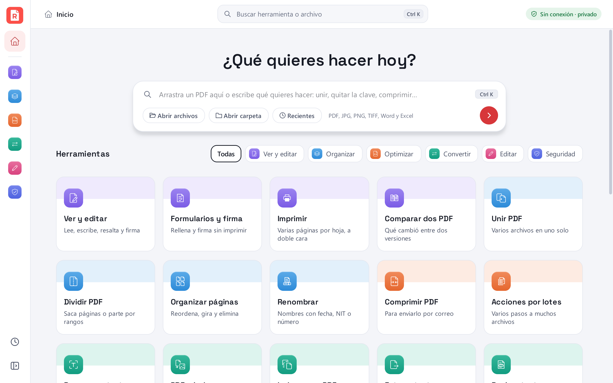 | 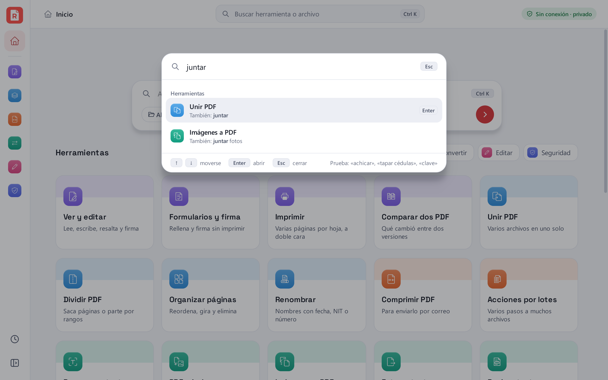 |
| **Censurar:** cédula, NIT, celulares, correos y cuentas | **Comprimir:** un catálogo de 28,4 MB queda en 168 KB |
| 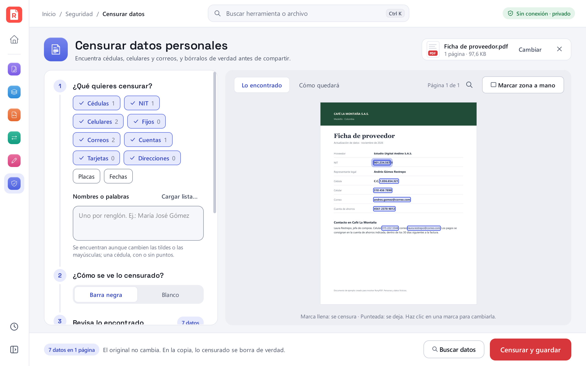 | 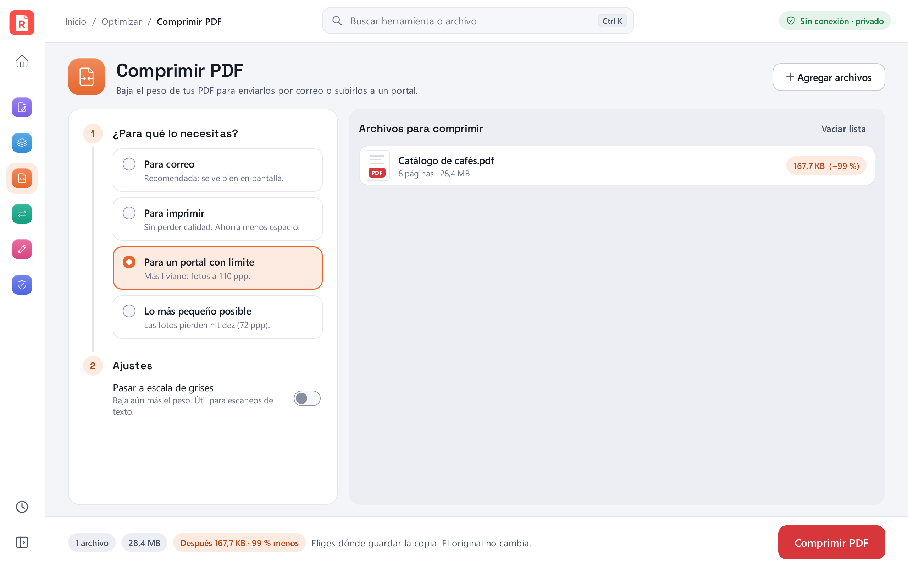 |
| **Organizar páginas** | **OCR:** el acta escaneada ya se puede buscar |
| 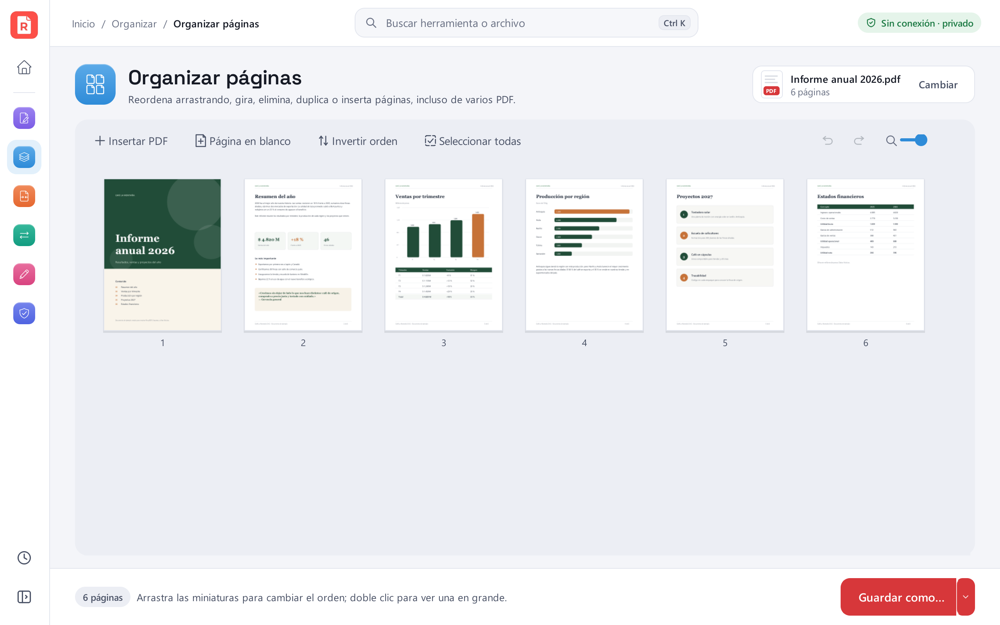 | 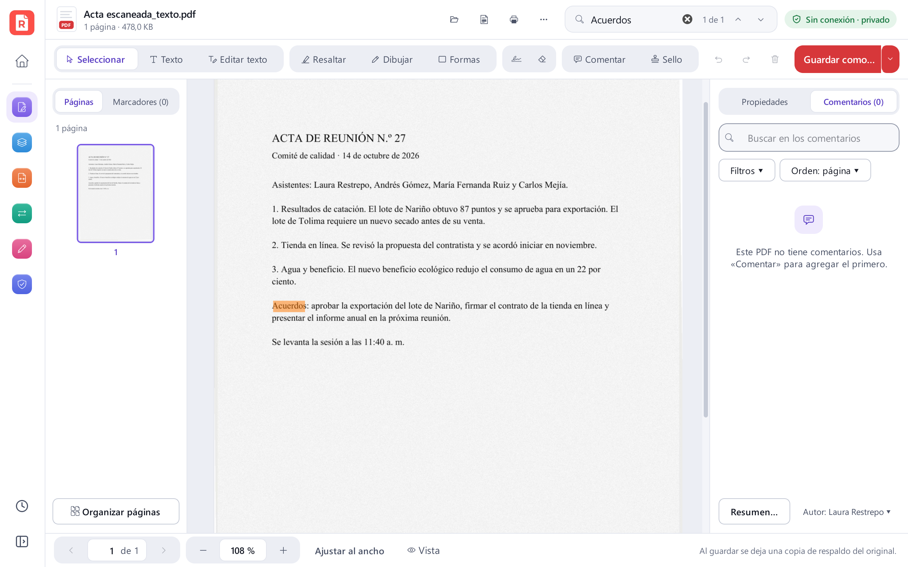 |

Los documentos de las capturas son de una empresa ficticia y se generan con `scripts/demo_docs.py`; las capturas
salen de la interfaz real con `scripts/capturas.py`.

## Descargar

1. Descarga **`RonyPDF-…-portable.zip`** de la [última versión](https://github.com/Rony0218/RonyPDF/releases/latest).
2. Clic derecho sobre el zip → **«Extraer todo…»**. Desde dentro del zip no funciona.
3. Abre la carpeta `RonyPDF` y haz doble clic en **`RonyPDF.exe`**. Conserva la carpeta completa: el `.exe` necesita
   la carpeta `_internal` que está a su lado.

Para actualizar, extrae la versión nueva encima de la anterior y acepta reemplazar los archivos: tus ajustes, firmas,
sellos y respaldos se conservan.

> **Descárgalo solo desde la [página de versiones](https://github.com/Rony0218/RonyPDF/releases) de este
> repositorio.** Cada versión se compila en GitHub, no en un computador personal, y trae su SHA-256 y una atestación
> de procedencia firmada para comprobar que el archivo es el original: en [SECURITY.md](SECURITY.md) está cómo.
>
> **Windows SmartScreen** puede avisar que es una aplicación desconocida, porque el ejecutable no está firmado con un
> certificado de pago: «Más información» → «Ejecutar de todas formas».

La lista de recientes, el estado del menú, la página donde quedaste en cada documento y las preferencias del visor y
de impresión se guardan en `RonyPDF.json` junto al `.exe` (o en `%APPDATA%\RonyPDF` si esa carpeta no permite
escribir). Guarda rutas, nunca copias de los documentos, y también el nombre con el que firmas tus comentarios. Al
lado de ese archivo quedan, solo si las usas, estas carpetas: `RonyPDF_firmas` (tus firmas), `RonyPDF_sellos` (tus
sellos), `RonyPDF_respaldos` (las copias de respaldo de «Guardar»), `RonyPDF_recuperacion` (el trabajo sin guardar),
`RonyPDF_flujos` (los flujos de «Acciones por lotes») y `RonyPDF_lotes` (para deshacer un renombrado), además de
`RonyPDF_diccionario.txt` (tus palabras para el OCR). Todas se pueden borrar. No escribe en el registro de Windows:
solo lo lee para saber si hay Office.

**Si RonyPDF se cierra de forma inesperada**, al abrirlo de nuevo ofrece «Guardar informe…»: un archivo de texto
con los datos técnicos de las últimas sesiones (versiones, pantalla y operación en curso, y dónde se detuvo el
programa), sin el contenido de tus documentos ni sus rutas. Esas sesiones se guardan en `RonyPDF_registros`, junto
a `RonyPDF.json` (solo las 10 últimas), y nunca salen del equipo: el informe lo compartes tú si quieres, por
ejemplo en un *issue* del repositorio.

## Cómo está hecho

- **Python 3.12 + [PySide6](https://doc.qt.io/qtforpython-6/)** (Qt 6) para la interfaz, con una hoja de estilos
  propia generada desde los tokens de diseño de `tema.py` (colores por categoría, tipografía y espaciado), un carril
  de categorías, la paleta Ctrl K y una plantilla común para las herramientas (`ToolPage`: pasos numerados a la
  izquierda, vista previa a la derecha y una barra con un solo botón principal).
- **[PyMuPDF](https://pymupdf.readthedocs.io/)** (MuPDF) para todas las operaciones PDF, y su **Tesseract integrado**
  para el OCR con los modelos `spa` y `eng` de [tessdata_fast](https://github.com/tesseract-ocr/tessdata_fast).
- El editor es una `QGraphicsScene` en puntos PDF: lo que dibujas se guarda como anotaciones o contenido real
  (las zonas borradas usan *redaction*, así que el texto oculto desaparece del archivo).
- Las tareas pesadas corren en segundo plano con barra de progreso, y un candado protege a MuPDF, que no es seguro
  entre hilos.
- Las herramientas más nuevas viven cada una en su módulo `*_ui.py` y se registran solas (`extensiones.py`) en el
  menú lateral, el buscador, las tarjetas del inicio y el encabezado del visor.
- **Office a PDF** maneja el Office instalado por COM desde un subproceso de PowerShell (sin dependencias nuevas) y,
  si no hay Office, LibreOffice sin ventanas. Los `.xlsx` y los `.docx` de «Solo texto y títulos» se escriben
  directamente con `zipfile`, sin Office.
- **Imprimir** usa QtPrintSupport: la vista previa, la impresora y «Guardar como PDF» comparten el mismo dibujo de
  cada hoja.
- **Comentarios:** el archivo del disco más una lista de operaciones es la verdad. La misma función las aplica al
  documento en memoria (así MuPDF las dibuja tal como quedarán) y a una copia recién abierta al guardar; deshacer y
  rehacer solo quitan o vuelven a poner operaciones.
- **Guardado:** los PDF se escriben en un temporal de la misma carpeta, se vacían al disco (`fsync`) y solo entonces
  reemplazan el destino: si se va la luz, queda el archivo nuevo completo o el anterior. El guardado incremental de
  MuPDF agrega los cambios al final de una copia exacta del original.
- **Comparar** alinea el texto con `difflib` (primero por renglones y luego palabra por palabra) y compara la
  apariencia con operaciones de bits sobre las páginas dibujadas, sin numpy.
- **OCR:** la inclinación se mide con perfiles de proyección en Python puro (±0,1°) y el diccionario español se saca
  del propio modelo `spa.traineddata`.
- **582 pruebas** con pytest: `tests/test_core.py` cubre cada operación PDF y `tests/test_gui.py` recorre la interfaz
  sin pantalla (Qt *offscreen*); cada herramienta nueva trae las suyas (`test_formularios.py`, `test_censura.py`,
  `test_oficina.py`, `test_imprimir.py`, `test_visor.py`, `test_comentarios.py`, `test_guardado.py`,
  `test_comparar.py`, `test_ocr.py` y `test_lotes.py`), `test_integracion.py` prueba lo que une a unas con otras y
  `test_diseno.py` vigila la plantilla y que cada pantalla quepa sin recortes en una ventana de 1000 × 660.
  Las que usan Office de verdad se saltan si no está instalado, y ninguna envía nada a una impresora. Corren en
  Windows con GitHub Actions en cada cambio.
- **PyInstaller** empaqueta todo en una carpeta portable (`--onedir`) que se distribuye en un zip. No es un solo
  `.exe` a propósito: un `.exe` «onefile» se descomprime entero en `%TEMP%` cada vez que se abre, lo que es lento
  en discos mecánicos y deja basura si la app se cierra mal. Al publicar una etiqueta `vX.Y.Z`, GitHub Actions
  compila el zip y lo adjunta a la versión con sus sumas SHA-256 y una atestación de procedencia.

Unas 46.500 líneas de Python en `ronypdf/` y 12.500 de pruebas.

## Proceso de diseño

La primera versión funcionaba, pero se veía como una herramienta interna. El rediseño se hizo con IA, comparando
opciones sobre la app real antes de decidir:

1. **Maquetas.** Codex propuso tres direcciones a partir de capturas de la versión 1.0. La versión 1.1
   combinó la pantalla de inicio de la primera con el editor de la segunda.
2. **Íconos en azulejo de color** (versión 1.1), generados con Codex como una hoja de 5 × 5 y recortados
   automáticamente por `scripts/slice_icons.py`.
3. **Ocho estilos más de íconos** (A–H), generados con Codex y con Antigravity (Gemini / Nano Banana) a partir de
   la misma lista, y comparados dentro de la app.
4. **Decisión:** la opción **F**, de línea gris con un acento rojo de marca, por ser la más sobria y legible a 20 px,
   con el logo «hoja con R» sobre azulejo rojo como único elemento de color fuerte.

| Opciones A–D | Opciones corporativas E–H |
|---|---|
| 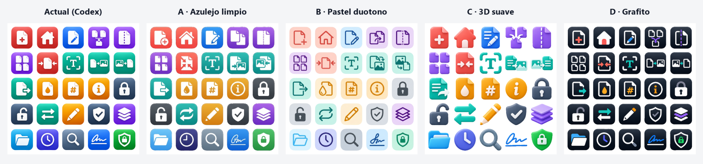 | 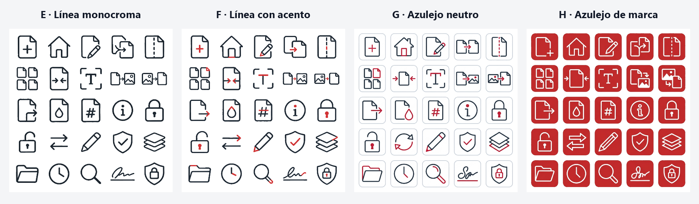 |

`scripts/finish_icons.py` deja los íconos listos: pasa cada píxel a los dos colores exactos de la marca (así el
interior queda transparente sobre cualquier fondo), reacomoda los dos íconos anchos y recorta el logo. Todo el
proceso, con las maquetas y los encargos que se les dieron a las IA, está en [`docs/diseno`](docs/diseno/README.md).

### Versión 2.0: un rediseño completo

Con todas las funciones en su sitio, la interfaz seguía viéndose básica: tarjetas blancas apiladas, casillas
sueltas y botones desactivados por todas partes. Para la 2.0 se armó primero un sistema de diseño (colores,
tipografía, espaciado y 14 componentes) y un prototipo navegable de las pantallas clave, y solo después se pasó a
la app:

- **Un color pastel por categoría** (ver, organizar, optimizar, convertir, editar y seguridad), en el carril, los
  azulejos y los encabezados. El rojo de la marca queda solo para el logo y el botón principal de cada pantalla.
- **Una sola plantilla para las 26 herramientas:** encabezado con el archivo en una ficha, pasos numerados,
  vista previa en vivo y una barra de acción con un resumen de lo que va a pasar.
- **Controles que dicen lo que hacen:** interruptores, segmentos, fichas y tarjetas de opción en lugar de
  casillas y botones de opción; lo que no aplica se esconde en vez de mostrarse desactivado.
- **Paleta Ctrl K** que entiende palabras coloquiales («juntar» encuentra Unir PDF, «quitar clave» encuentra
  Quitar contraseña), y títulos en Space Grotesk.

El código se escribió con [Claude Code](https://claude.com/claude-code) como compañero de programación.

## Compilar y ejecutar

Requiere Python 3.10 o superior en Windows.

```powershell
powershell -ExecutionPolicy Bypass -File build.ps1      # crea .venv, dist\RonyPDF\ y el zip portable
.venv\Scripts\python.exe run.py                         # o ejecutarla sin compilar
```

Pruebas:

```powershell
.venv\Scripts\python.exe -m pip install -r requirements-dev.txt
.venv\Scripts\python.exe -m pytest
.venv\Scripts\python.exe scripts\comprobar_arranque.py   # abre la ventana sin pantalla y recorre cada herramienta
```

`comprobar_arranque.py` falla si al abrir cualquier herramienta aparece un error, una advertencia de Qt o de Python o
un diálogo inesperado. Con la variable `CAPTURAS=carpeta` guarda además una captura de cada pantalla a 1000 y a
1240 px, y del visor también con el menú lateral abierto.

Al terminar, `build.ps1` ejecuta `RonyPDF.exe --comprobar-herramientas` y falla si al ejecutable le falta alguna de
las herramientas que se cargan por nombre (`ronypdf\*_ui.py`).

Para regenerar las capturas: `python scripts/demo_docs.py` y luego `python scripts/capturas.py`.

**Más idiomas para el OCR:** crea una carpeta `tessdata` junto a `RonyPDF.exe` y copia ahí los `.traineddata` que
quieras de [tessdata_fast](https://github.com/tesseract-ocr/tessdata_fast), junto con `spa` y `eng`.

## Estructura

```
ronypdf/
  core.py         operaciones PDF sin interfaz: unir, dividir, comprimir, OCR, aplicar ediciones…
  viewer.py       visor y editor
  visor_texto.py, visor_paneles.py   selección de texto, marcadores y enlaces del visor
  organizer.py    organizador visual de páginas
  tools.py        pantalla de cada herramienta
  extensiones.py  registro de las herramientas que viven en módulos *_ui.py
  formularios.py, firmas.py, formularios_ui.py   rellenar formularios y firmar
  imprimir.py, imprimir_ui.py                    imprimir con vista previa
  oficina.py, oficina_ui.py                      Word, Excel y PowerPoint a PDF, y PDF a Word y Excel
  censura.py, censura_ui.py                      censurar datos personales y quitar datos ocultos
  comentarios.py, sellos.py, comentarios_ui.py   tus comentarios y «Mis sellos»
  guardado.py, guardado_ui.py                    «Guardar» con respaldo, autoguardado y recuperación
  comparar.py, comparar_ui.py                    comparar dos PDF
  ocr.py, ocr_ui.py                              OCR con enderezado y revisión de palabras dudosas
  lotes.py, renombrar.py, lotes_ui.py            acciones por lotes y renombrar por contenido
  gui.py          ventana principal
  home.py         pantalla de inicio
  sidebar.py      menú lateral contraíble con buscador
  widgets.py      tareas en segundo plano, selectores de archivos, contraseñas
  art.py, icons.py, style.py   íconos, ilustraciones y hoja de estilos
  assets/tiles/   íconos de la app
  tessdata/       modelos de idioma del OCR
scripts/          compilación, íconos, documentos de ejemplo, capturas y prueba de arranque
tests/            pruebas de la lógica PDF, de cada herramienta y de la interfaz
docs/             capturas, íconos de este README y proceso de diseño
video/            video de presentación hecho con código (HTML animado → MP4)
```

## Licencia

RonyPDF se distribuye bajo la **[GNU AGPL-3.0](LICENSE)**, la misma licencia de MuPDF/PyMuPDF que usa por dentro:
puedes usarla, estudiarla, modificarla y compartirla, siempre que compartas también el código de tus cambios.
Con los [términos adicionales](TERMINOS-ADICIONALES.md) que permite su sección 7, una versión modificada debe decir
que es distinta del original, conservar el aviso de autoría y usar otro nombre y otro logo: solo las versiones
publicadas aquí son RonyPDF.

Componentes de terceros: [PyMuPDF / MuPDF](https://pymupdf.readthedocs.io/) (AGPL-3.0, Artifex),
[Qt / PySide6](https://doc.qt.io/qtforpython-6/) (LGPL-3.0), Tesseract y los modelos de
[tessdata_fast](https://github.com/tesseract-ocr/tessdata_fast) (Apache-2.0).
La letra de los títulos es [Space Grotesk](https://github.com/floriankarsten/space-grotesk) (SIL Open Font License 1.1;
texto completo en `ronypdf/assets/fonts/OFL-SpaceGrotesk.txt`).

## Autor

Hecho por **Rony Guerrero**, que construye herramientas que ahorran tiempo: automatización, aplicaciones a la medida
e IA aplicada. Más en **[ronyguerrero.com](https://ronyguerrero.com)**.
