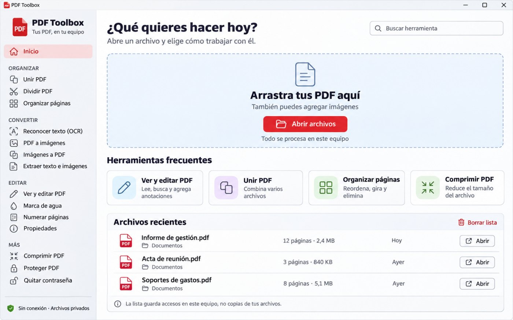
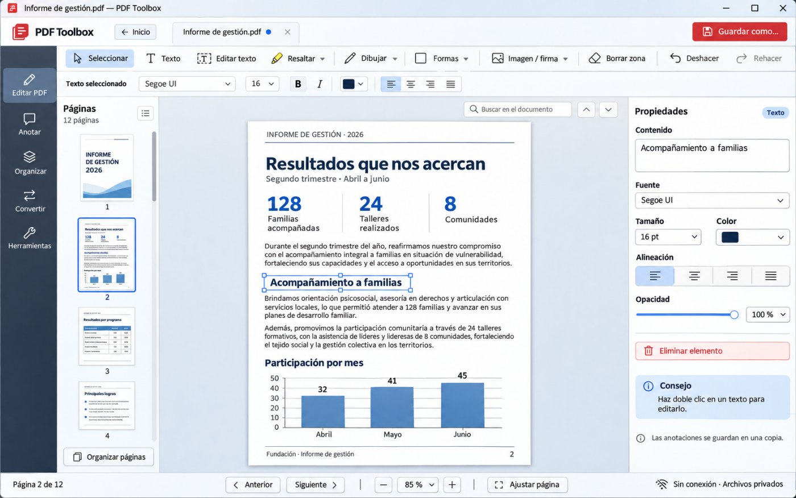
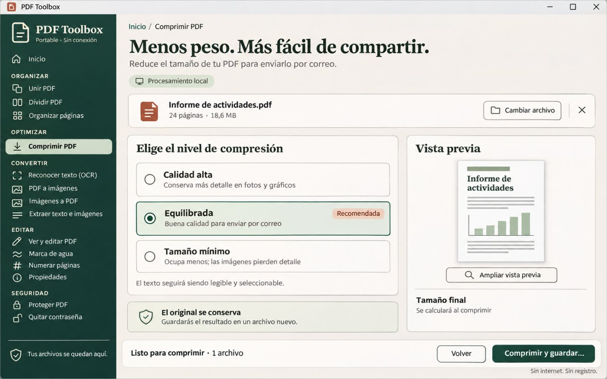
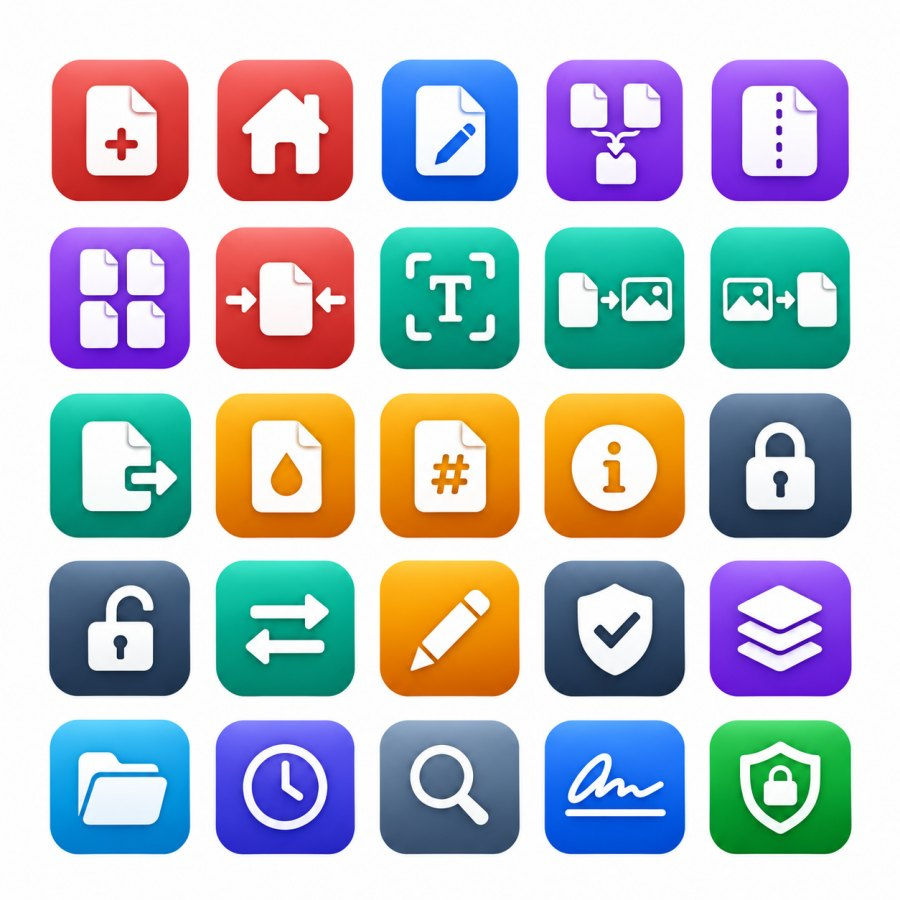
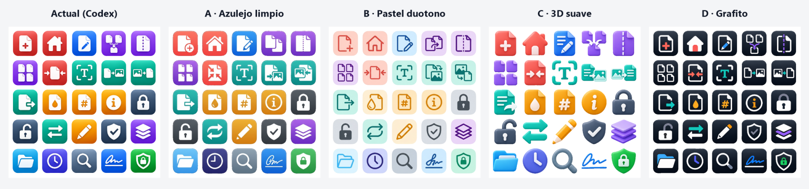
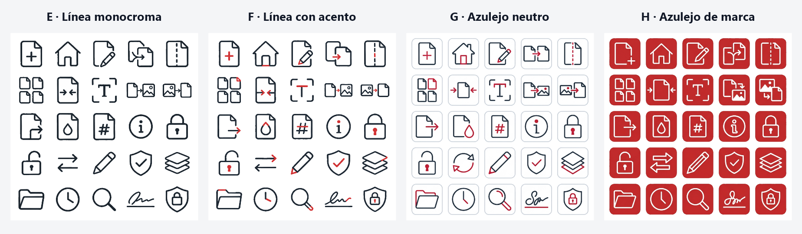
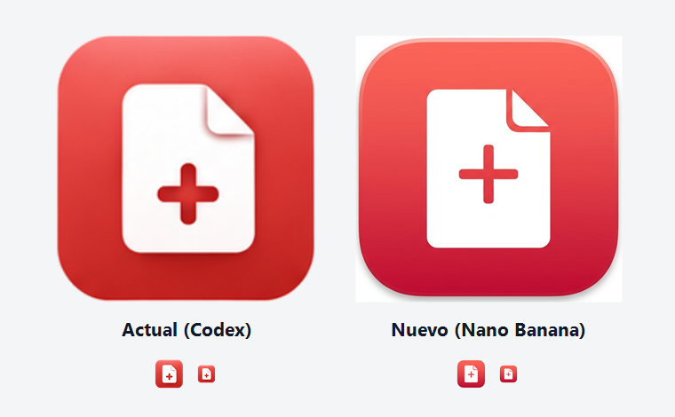
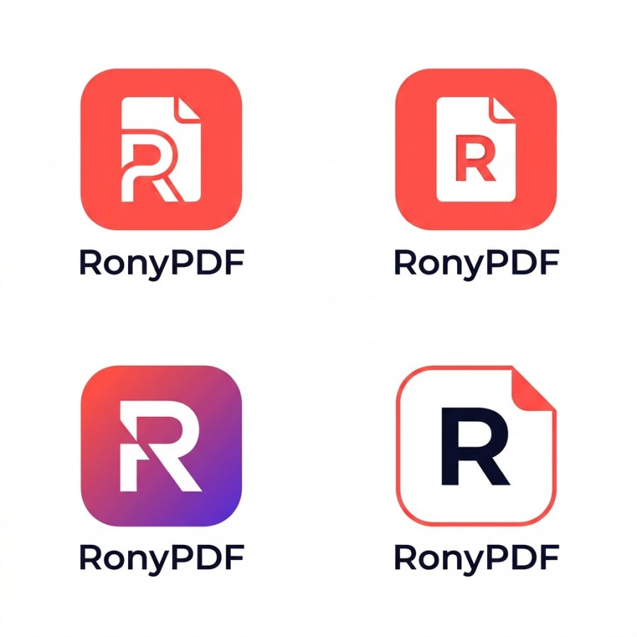
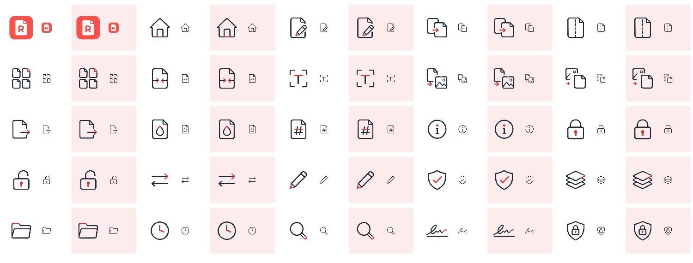

# Proceso de diseño de RonyPDF

RonyPDF empezó como «PDF Toolbox», una herramienta interna con una interfaz correcta pero plana. Esta carpeta
guarda cómo se rediseñó con ayuda de IA: qué se pidió, qué salió y por qué se eligió cada cosa. Las imágenes
están reducidas; las dos hojas de `fuentes/` están en tamaño completo porque de ellas salen los íconos de la app.

## 1. Tres direcciones de diseño (Codex)

A Codex se le dieron cuatro capturas de la versión 1.0 y este encargo, resumido:

> Eres diseñador de producto senior. Crea **3 propuestas de rediseño distintas** como maquetas de la ventana
> completa (16:10), con textos en español: una **pantalla de inicio** más amable (zona para soltar archivos,
> recientes, herramientas con íconos expresivos), el **visor/editor** como espacio de trabajo profesional
> (miniaturas, barra contextual, panel de propiedades) y **una dirección visual alternativa** para toda la app.
> Para cada una: concepto, paleta, tipografía y de 3 a 6 cambios realizables en Qt/PySide6. Pensado para personas
> no técnicas.

| Inicio | Visor y editor | Estilo alternativo |
|---|---|---|
|  |  |  |

La versión 1.1 tomó la pantalla de inicio de la primera y el editor de la segunda. Antes de programarla se
maquetó en un lienzo de diseño para aprobarla, con el menú lateral agrupado, contraíble y con íconos.

## 2. Íconos en azulejo de color (versión 1.1, Codex)

Para que la IA entregara íconos utilizables, el encargo fija un formato que se puede recortar con código: **una sola
hoja cuadrada de 5 × 5, fondo blanco puro, un ícono por celda, sin textos**, en un orden fijo (logo, inicio, ver y
editar, unir, dividir… hasta «sin conexión»). `scripts/slice_icons.py` detecta la cuadrícula, quita el fondo y
guarda cada ícono como PNG transparente de 256 px.



## 3. Ocho estilos más, comparados dentro de la app

Con la misma lista de 25 íconos se pidieron ocho estilos, repartidos entre **Codex** y **Antigravity** (Gemini con
Nano Banana). Cada hoja se recortó y se probó en la app real, con el menú abierto y contraído, porque un ícono que
se ve bien suelto puede perderse a 20 px.

| | Estilo | Hecho con |
|---|---|---|
| A | Azulejo limpio (degradado del color de su sección) | Antigravity |
| B | Pastel duotono | Antigravity |
| C | 3D suave tipo Fluent | Codex |
| D | Azulejo grafito con un detalle de color | Codex |
| E | Línea monocroma gris pizarra | Codex |
| F | **Línea gris con un único acento rojo de marca** | Codex |
| G | Azulejo blanco con borde fino y acento rojo | Antigravity |
| H | Azulejo rojo de marca con línea blanca | Antigravity |




Para E y F el encargo pedía, entre otras cosas: *trazo idéntico en los 25 (2 px en una cuadrícula de 24),
puntas redondeadas, el mismo tamaño visual en todos, máximo dos elementos por ícono y, en F, un solo detalle rojo
que nunca ocupe más de una cuarta parte del ícono.*

## 4. Logo

Se compararon el logo de la versión 1.1 (Codex) y uno de Nano Banana, y después cuatro propuestas para el nombre
nuevo, RonyPDF (Antigravity).

| Versión 1.1 frente a Nano Banana | Propuestas para RonyPDF |
|---|---|
|  |  |

## 5. Decisión

- **Íconos F:** son los más sobrios y legibles a tamaño de menú, y el acento rojo amarra todo a la marca sin
  llenar la pantalla de colores.
- **Logo n.º 2**, la hoja blanca con una «R» sobre azulejo rojo: dice «documento» y «Rony» a la vez, y es el único
  elemento de color fuerte, así que se reconoce en la barra de tareas.



## 6. De la imagen de la IA a los íconos de la app

```powershell
python scripts/slice_icons.py docs/diseno/fuentes/hoja-iconos-F.png --uniform --out build/tiles-F
python scripts/finish_icons.py build/tiles-F --logo docs/diseno/fuentes/logos-ronypdf.png
```

- `--uniform` recorta los 25 con el mismo cuadro, para que conserven el mismo tamaño y grosor de trazo.
- `finish_icons.py` pasa cada píxel a los dos colores exactos de la marca (#1F2937 y #D63A3A) con su transparencia.
  La IA había pintado de gris muy claro el interior de las figuras, y sobre el fondo rojizo del menú activo se veía
  como un parche. También reacomoda en diagonal «PDF a imágenes» e «Imágenes a PDF», que eran dos dibujos lado a lado
  y se veían más pequeños que el resto, y recorta el logo de la hoja de propuestas.
